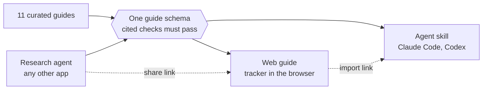
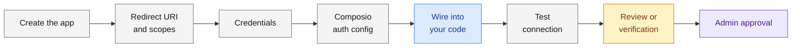
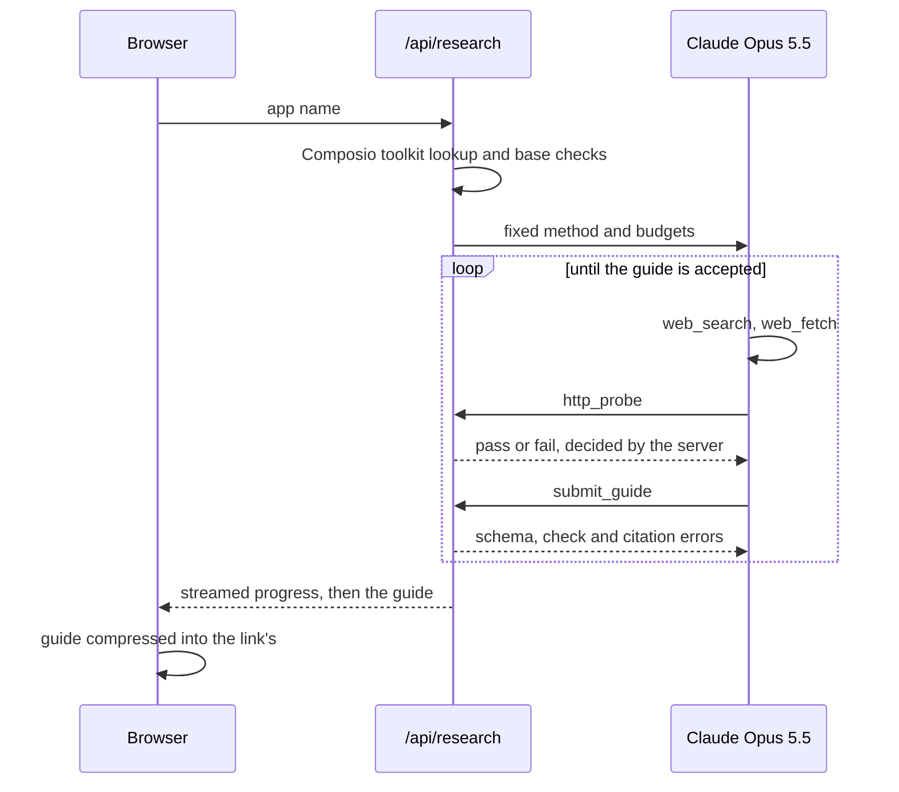
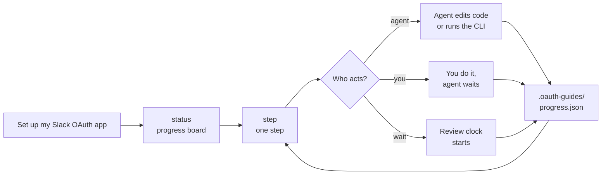

# OAuth Guides

Guides for setting up **your own OAuth app** with a provider and connecting it to Composio, instead of Composio's managed app. Each guide covers the steps and who does each one, hands-on time, approval waits, blockers, and where every claim comes from.

**Live:** https://oauth-guides-xi.vercel.app · **Generate a guide:** https://oauth-guides-xi.vercel.app/new · **Agent skill:** [`skills/oauth-guides`](skills/oauth-guides)



## Library

| Setup shape | Guides |
|---|---|
| Instant, no review | [GitHub](https://oauth-guides-xi.vercel.app/github), [Linear](https://oauth-guides-xi.vercel.app/linear) |
| Install or user caps until approval | [HubSpot](https://oauth-guides-xi.vercel.app/hubspot) (25 installs), [Dropbox](https://oauth-guides-xi.vercel.app/dropbox) (50 users, then 2 weeks) |
| Optional marketplace review | [Slack](https://oauth-guides-xi.vercel.app/slack), [Notion](https://oauth-guides-xi.vercel.app/notion), [Jira](https://oauth-guides-xi.vercel.app/jira) |
| Scope-driven verification plus a security audit | [Gmail](https://oauth-guides-xi.vercel.app/gmail) (CASA) |
| Blocker in your user's organization | [Outlook](https://oauth-guides-xi.vercel.app/outlook) (admin consent), Jira (site admins) |
| Business verification plus per-permission review | [Meta](https://oauth-guides-xi.vercel.app/meta) |
| Two-stage publish review with security docs | [Zoom](https://oauth-guides-xi.vercel.app/zoom) |

## Use it

- **Web:** open a guide and work through it step by step. Progress is saved in your browser.
- **Unknown app:** enter its name at `/new`. In about 3 minutes you get a guide in the same format, as a shareable link.
- **In your coding agent:**
  ```bash
  # Claude Code
  mkdir -p ~/.claude/skills && curl -fsSL https://oauth-guides-xi.vercel.app/skills/oauth-guides.tar.gz | tar -xz -C ~/.claude/skills
  # Codex
  mkdir -p ~/.agents/skills && curl -fsSL https://oauth-guides-xi.vercel.app/skills/oauth-guides.tar.gz | tar -xz -C ~/.agents/skills
  ```
  Then ask "Set up my own Slack OAuth app for Composio".

## Run locally

```bash
npm install
npm run dev                       # http://localhost:3000 (also bundles the skill)
npm run probe [-- slack]          # re-run the credential-free live checks
npm run validate                  # schema + every cited check exists and passed
npm run build                     # fails on an invalid guide
npm run research -- "Pipedrive"   # research agent in the terminal (ANTHROPIC_API_KEY in .env.local)
```

The library needs no credentials. Only the research agent needs `ANTHROPIC_API_KEY`.

```
src/lib/guide-schema.ts      the contract every guide follows (curated and generated)
src/data/guides, probes      guide data and live-check results
src/components/guide/        one template: step nav, step view, help, agent prompt
src/lib/research/            research agent: prompt, tools, probes, validation
skills/oauth-guides/         the skill: SKILL.md, scripts/oauth.mjs, bundled guides
```

## How a guide works

Every guide follows the same shape. What changes from provider to provider is the content and the steps that come after the test connection.



**Who acts:** grey is you, blue is an agent, amber is the provider's clock (quoted in its own words), purple is someone in your user's organization.

Each step has:
- short instructions, values to copy, code, and links to the right console page;
- **Stuck on this step?**: our explanation of real errors with the fix, then the provider's support route with a ready-to-send message;
- **Copy prompt** on the 31 steps an agent can do. The prompt is built from the step's own data;
- **Checked live**, **Not confirmed** and **Sources** at the end. The build fails if a step has none of these.

## Research agent



**What the server rejects:**
- a guide that fails the schema;
- a citation of a check that failed or never ran;
- a citation of a page the agent didn't fetch in that run.

**Method:** Composio toolkit lookup, then official docs only, then blockers (reviews, caps, admin consent, verification, cost, token lifetimes, conflicting docs), then live checks, then submit.

**Budget:** 6 searches and 12 page fetches per run, and submit-only after 150 seconds, so a run fits Vercel's 300-second limit.

**Measured runs:** Dropbox 155s, Linear 183s, Zoho CRM 169s, Calendly 120s (about $0.96).

**Sharing needs no database:** the whole guide lives in the link.

## Agent skill



- **One script, no CLI to install.** `scripts/oauth.mjs` needs Node 18+ and no dependencies. It renders the board, steps and help as terminal UI, and the agent shows that output verbatim.
- **Progress lives in the project** (git-ignored). Steps can be done, skipped, blocked with a reason, or waiting, which is shown against the provider's stated wait.
- **New providers:** the agent researches with its own web tools; the script runs the live checks and `validate` enforces the same rules as the site. Guides generated on the web can be imported from their share link.
- **Tested in Claude Code** (headless):
  - It picked the skill from a plain request, recorded progress across turns, and asked only for the public Client ID.
  - It researched Calendly from scratch into a valid 8-step guide.

## Key decisions

| Decision | Why |
|---|---|
| Web first, plus a skill | Links can be shared with people who won't install anything, and developers who live in an agent get the same guides there. |
| Steps and pointers, not prose | Developers scan. Text is capped at 60 characters for titles and 160 per instruction. |
| No tiers or metric panels | Hands-on time, approval wait, review and cost answer "how hard is it?" directly. |
| One schema for curated and generated guides | One format to learn, and the same checks apply to the agent's output. |
| Claude API directly, no framework | Server-side search and fetch plus three small tools fit in one streaming route. |
| The server judges checks and citations | The model can't pass its own checks or cite pages it didn't read. |

## How it was checked

1. **Written:** GitHub by hand as the reference; the other ten by research agents, each iterated until `npm run validate` passed.
2. **Live checks:** 162 credential-free probes, all passing on 2026-10-28.
3. **Fact-check:** two fresh agents re-checked every guide against current docs and fixed seven guides. For example:
   - Gmail's CASA self-scan is gone;
   - an Outlook error cause was wrong;
   - Slack's menu labels were out of date;
   - Meta was missing a token-lifetime warning.
4. **Agent vs curated:** the agent regenerated Linear and Dropbox. The steps matched, and it found a Dropbox review timeline the curated guide had missed. That's now fixed, and the prompt is updated.
5. **QA:**
   - all 131 steps clicked through at desktop and phone width;
   - 262 links checked;
   - the generator run end to end on the live site.

**Findings worth knowing:**
- Several Composio setup pages still show the old v1 callback.
- Google and Zoom need a redirect domain you've verified, which is why there's an optional "route the callback through your domain" step.
- Microsoft's default policy makes admin consent the norm for work accounts.
- HubSpot now only allows new apps created as projects.

## Not confirmed, and limitations

- **No real end-to-end connection:** none was run through a Composio auth config, because that needs real provider accounts. Each "Connect a test account" step says so.
- **Composio dashboard links:** they exist, but we couldn't see where they land after login.
- **Generated guides** are not reviewed by a person, and the page says so.
- **Progress doesn't sync:** it's stored per browser on the web and per project folder in the skill.
- **Codex** is untested.
- **The research agent's limits:** it must finish within 300 seconds, so large providers get thinner guides with more "Not confirmed" notes. Its rate limiting is best-effort.
